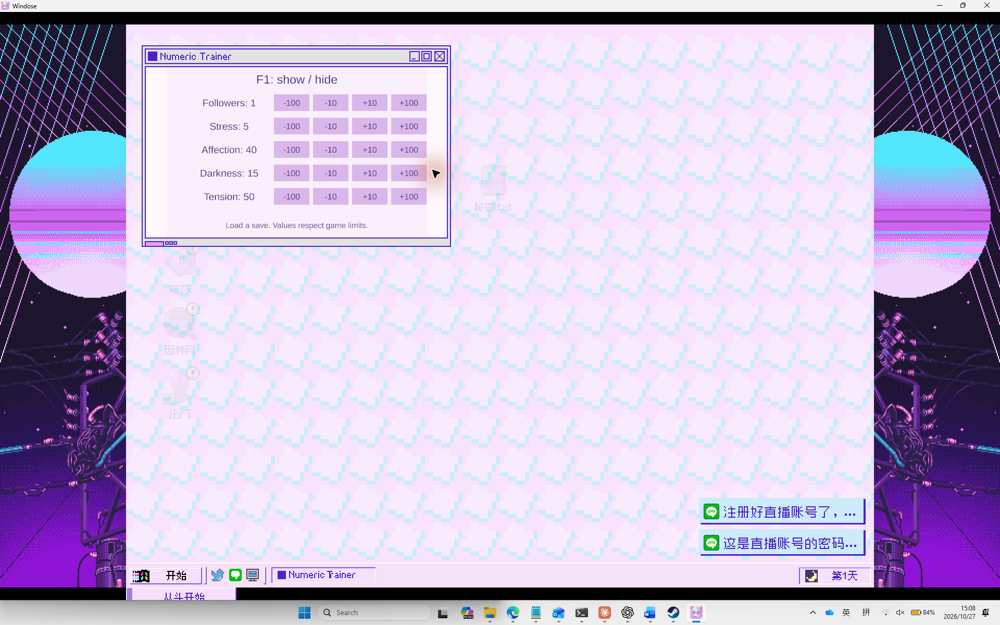

# NEEDY GIRL OVERDOSE — 数值修改器

Windows / Unity Mono 游戏内修改器。运行时将托管程序集注入游戏进程，不修改游戏程序集；面板使用游戏自己的窗口框架。

## 截图

## 使用

1. 从 Steam 启动游戏并进入存档。
2. 双击 `Inject.cmd`，检查注入器是否报告程序集地址。
3. 切回游戏，按 F1 打开或关闭面板。退出游戏后需要重新注入。

提供粉丝、压力、好感度、病娇度和紧张度的增减按钮。数值限制由游戏自身接口提供。仅支持本地验证的 Windows x64、游戏 1.4.0 / Unity 2022.3.22f1 Mono 版本；其他版本未经验证。请先备份存档。避免对同一游戏进程重复注入。

## 状态与限制

已在恢复原版游戏程序集后验证进程注入、F1 和游戏原生窗口显示。已实测注入版压力从 5 增加到 15，再恢复为 5。其余四项读取正常，写入未逐项测试。面板使用游戏 MyPicture 窗口模板，其原有应用关联可能影响与图片窗口同时使用的行为，尚未验证。

## 构建

`src/InjectedTrainer.cs` 是修改器源码；构建时引用游戏 `Windose_Data/Managed` 内的 UnityEngine、UnityEngine.CoreModule、UnityEngine.UIModule、UnityEngine.UI、UnityEngine.TextRenderingModule、UnityEngine.InputLegacyModule、Unity.TextMeshPro 程序集。不包含或重新分发游戏程序集。

## 第三方组件

`bin/smi.exe` 和 `bin/SharpMonoInjector.dll` 来自 [SharpMonoInjector 2.2](https://github.com/warbler/SharpMonoInjector)，MIT 许可，许可文本见 `licenses/SharpMonoInjector-MIT.txt`。
